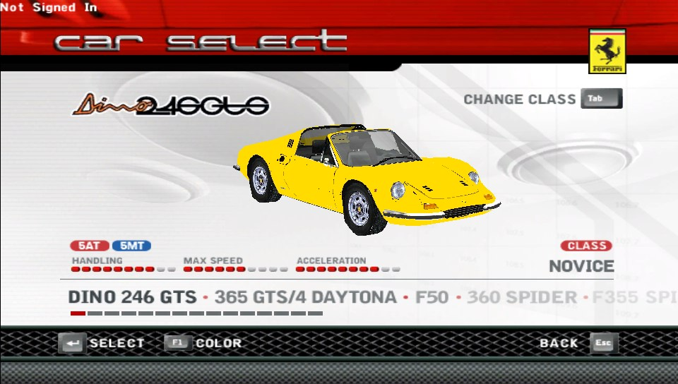
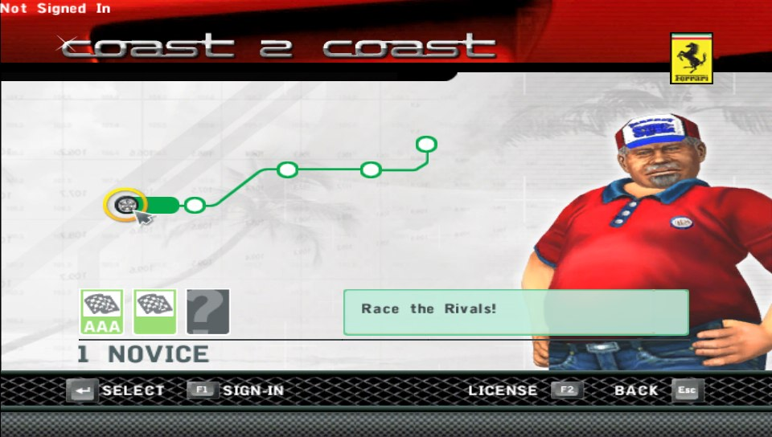
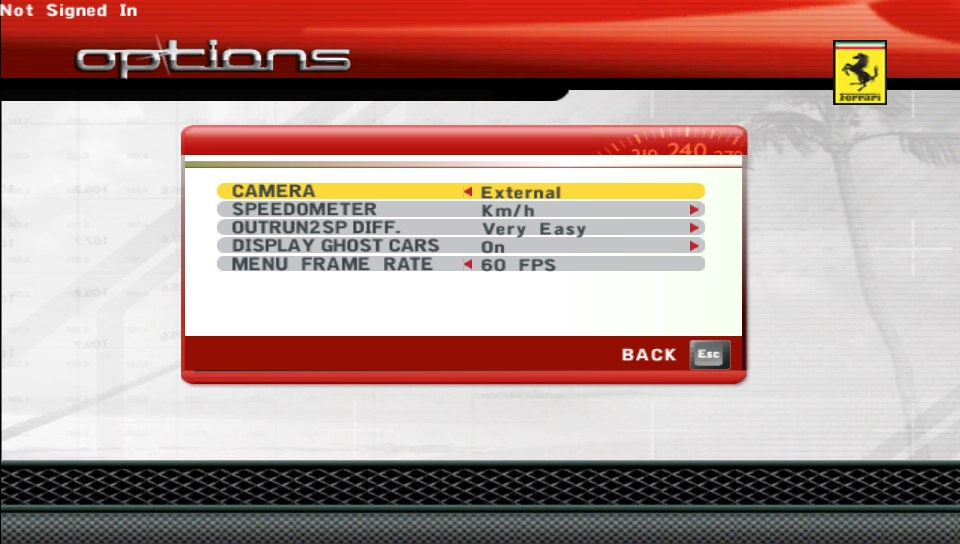

# OutRun 2006: Coast 2 Coast — PS Vita Port

> **English** | [Español](README_ES.md)

Native port of **OutRun 2006: Coast 2 Coast** (PC / Steam version) for **PlayStation Vita**, based on [`outrun2-decomp`](https://github.com/r4dius/outrun2-decomp).

Runs the decompiled PC game engine natively on **ARM Cortex-A9 + vitaGL (PowerVR SGX543MP4+)** at native **960×544** resolution and **locked 30 FPS in races** (up to 60 FPS in menus).

## Screenshots (PS Vita — 960×544)

| Title Screen | Main Menu |
| :---: | :---: |
|  |  |

| Car Select | Music Select |
| :---: | :---: |
|  |  |

| Race Start (Flagman) | In-Game Race |
| :---: | :---: |
|  |  |

| OutRun 2 SP — Heart Attack | Settings |
| :---: | :---: |
|  |  |

---

## Current Status — What Works

- **Native PS Vita resolution (`960×544`, 16:9).**
- **Locked 30 FPS during gameplay** with two 60 Hz simulation ticks per frame (full 1× game speed, no slow motion) and **optional 60 FPS in menus** (`Options > Settings > MENU FRAME RATE`).
- **Multi-core PS Vita architecture:**
  - **Core 0:** dedicated `vitaGL` / GPU thread (asynchronous double command buffer).
  - **Core 1:** game logic, physics, and scene traversal.
  - **Core 2:** audio, parallel culling jobs, and asynchronous `.sz` decompression (prevents hitches when loading road chunks or traffic).
- **Playable modes:** OutRun (OutRun 2), Time Attack (OutRun 2), Coast 2 Coast (standard races / rivals), Showroom, Car Select, Rankings, Licenses, and Options.
- **Audio and music:** original sound effects and music (Vorbis `.ogg` support).
- **Flagman race-start intro camera**, savegames/licenses in `ux0:data/outrun2006/SaveGame/`, and configuration via `options.ini` (`sd_logs=0` by default so no log files are written to the SD card).

---

## What Remains To Be Completed / Known Issues

- **Coast 2 Coast Mode — Clarissa Missions (`variant 5` / Request Mode):**
  - All 82 bulk logic functions are already compiled in `vita/source/bulk_vita_tr.cpp`, but ~51 external services still need to be wired in `src/platform/race_traffic_runtime.cpp` (14 matrix/vector math helpers, 3 CRT helpers, and ~34 mission/HUD getters). It currently enters the race / black screen when hitting the first unwired service (`0x48B140`).
- **Single Player & OutRun 2 SP:**
  - **OutRun 2 SP — Time Attack:** hangs on a black screen (similar to Clarissa missions).
  - **Heart Attack (OutRun 2):** the mission prompt bubble does not appear on screen (only the mission start/end markers on the road appear).
  - **Heart Attack (OutRun 2 SP):** the mission prompt bubble appears, but mission events (such as spawning traffic/objectives) do not trigger (only the mission start/end markers on the road appear).
- **Online / LAN Multiplayer:**
  - Not implemented or tested on PS Vita.

---

## Technical Limitations on PS Vita (Not Feasible / Unsupported)

- **Locked 60 FPS in races:** the main bottleneck is CPU-bound (ARM Cortex-A9 at 444 MHz running translated x86 code + physics + scene traversal). At 30 FPS with two 60 Hz ticks there is comfortable headroom (~5–8 ms spare); pushing 60 FPS in races causes constant drops.
- **Dynamic 6-face cubemap reflections and original DX9 shaders:**
  - The PC version renders a 6-face environment cubemap every frame (`0x414340`) and uses DirectX 9 vertex/pixel shaders (`vs_1_1` / `ps_1_4`).
  - On PS Vita the `vitaGL` fixed-function pipeline is used for performance, and the 6-face cubemap is disabled because it would multiply scene passes and tank FPS.
  - Due to `vitaGL` state limitations, mixing `glUseProgram` with fixed-function draws corrupts road rendering, and toggling `GL_LIGHTING` per car hurts Core 0 performance. Adding real GPU reflections/specular would require migrating the entire 3D renderer to a single unified Cg/GLSL shader.
- **Stencil volume car shadows (`car_shadows`):** disabled on Vita due to high fillrate/draw-call cost on PowerVR SGX543 (the projected shadow under the car is kept).
- **`D3DPT_POINTLIST` particles:** skipped in `vita_gl_d3d9.cpp` and capped at 64 active particles to maintain stable 30 FPS.

---

## Installation on PS Vita

### Requirements
1. PS Vita or PS TV with **HENkaku / Enso** and **VitaShell**.
2. **`libshacccg.suprx`** installed in `ur0:data/` (required by `vitaGL` / `vitashark` for runtime shader compilation — install via **ShaRKF00D**). *(`kubridge.skprx` is **not** required, since this is a native Vita port and not an Android `so-loader`.)*
3. An original **Steam** PC copy of **OutRun 2006: Coast 2 Coast** (DVD retail, No-CD, or patched/FXT executables are not supported), including `OR2006C2C.EXE` and all data folders (`BK`, `Cars`, `Chr`, `Common`, `Driver`, `Media`, `OSO`, `Scripts`, `Sound`, `Sprani`, `Sprite`, `Stage`, `Text`, etc.).
   - Supported `OR2006C2C.EXE` (**Steam**): `962,560` bytes — SHA-256: `4876712f501640951d892069db826e431aede3e4ab87686fc1d556e26df9fec1`
   - You do **not** need to run or unpack `OR2006C2C.EXE` on PC; the PS Vita port unpacks it automatically on first launch and generates `OR2006C2C.cache`.
4. ~1.5 GB free on `ux0:`.
5. **Overclock recommended** (e.g. PSVshell at 444/500 MHz CPU, 222 MHz GPU) to hold a steady 30 FPS across all stages.

### Steps
1. Install `OutRun2006.vpk` via **VitaShell** (accept extended permissions).
2. Create `ux0:data/outrun2006/` and copy **all** PC game files inside so that:
   ```text
   ux0:data/outrun2006/OR2006C2C.EXE
   ```
   sits alongside all data folders.
3. Launch **OutRun 2006 C2C** from the LiveArea. On first boot it automatically generates `OR2006C2C.cache` and `options.ini`.

---

## Configuration (`ux0:data/outrun2006/options.ini`)

Example configuration:

```ini
# OutRun 2006 PS Vita options v2 (edit or change in Options > Settings)
widescreen=1
framerate=60
lod_culling=6
lod_bias=1
sd_logs=0
```

- `framerate`: `60` or `30` — applies to **menus only** (also configurable in `Options > Settings > MENU FRAME RATE`); races are always locked to 30 FPS.
- `lod_culling`: projected-size culling distance (`7` = original PC, `6` = default, `5` or `4` = more aggressive culling of distant objects).
- `lod_bias`: geometric level-of-detail bias (`0` = original PC, `1` = default, `2..3` = switch to simpler meshes sooner).
- `sd_logs`: `0` = off (default, zero SD card log writes); `1` = enable telemetry/profiler logs (`profile_*.log`, `render_bottleneck_*.log`) for debugging.

---

## Optional PS Vita Asset Preparation Script (`tools/prepare_vita_assets.py`)

[tools/prepare_vita_assets.py](tools/prepare_vita_assets.py) combines two optional PC-side helpers into a single script you drop in your game root (next to `Cars/`, `mv/`, and `OR2006C2C.EXE`). It **never modifies your original files** and writes only the generated/modified files into `vita_assets/` preserving the exact game directory structure.

### What each module does

1. **Title Screen Intro (`--only-intro`, requires `ffmpeg`):**
   - **What it does:** Extracts 1 still frame (default at second `4.0`, adjustable with `--time`) and the original audio track from `mv/TitleScreen.bik` into `vita_assets/mv/TitleScreen.bmp` (~900 KB) and `vita_assets/mv/TitleScreen.ogg` (~1–1.5 MB, 48 kHz stereo Ogg Vorbis).
   - **How it works:** PS Vita builds do not bundle FFmpeg/Bink decoding. Instead, the Vita engine automatically loads `mv/TitleScreen.bmp` once as a GPU texture behind `PRESS START` and streams `mv/TitleScreen.ogg` in a loop via `libvorbisfile`, stopping cleanly when you press Start. You can also delete the ~78 MB `mv/TitleScreen.bik` from your Vita to save space.
2. **Player Car Polygon Optimization (`--only-cars`, requires `Blender`):**
   - **What it does:** Automatically finds **only** the 31 player car models (`Cars/obj_plcar*_pmt.sz`), decimates them in headless Blender (`--ratio 0.5` by default), protects glass/decals (`_Pass1`, with a `+3.5 mm` normal offset to prevent z-fighting), rebuilds native `PMT` triangle strips + `zlib` level 9, and saves them to `vita_assets/Cars/`.
   - **How it works:** Uses Blender's QEM `DECIMATE (COLLAPSE)` modifier while keeping UVs and materials intact, repacking both vertex and index buffers.

### How to run it and install on PS Vita

1. Copy [tools/prepare_vita_assets.py](tools/prepare_vita_assets.py) into your PC game root folder (next to `Cars/`, `mv/`, and `OR2006C2C.EXE`).
2. Run both tasks at once (or pick only one):
   ```bash
   python3 prepare_vita_assets.py               # Both intro + player cars
   python3 prepare_vita_assets.py --only-intro  # Intro BMP + OGG only (ffmpeg)
   python3 prepare_vita_assets.py --only-cars   # Player cars only (Blender)
   ```
   *(Useful options: `--ratio 0.5`, `--time 4.0`, `--out vita_assets`, `--ffmpeg /path/to/ffmpeg`, `--blender /path/to/blender`, `--dry-run`.)*
3. Open `vita_assets/` and drag-and-drop the generated `Cars/` and/or `mv/` folders onto `ux0:data/outrun2006/` on your PS Vita, overwriting when prompted.

### Estimated Impact on PS Vita (Example: Ferrari Dino, ~18,000 Unoptimized vs ~14,000 Optimized)

On PS Vita the player car is always in the foreground (never switching to a distant LOD). Using the **Dino (`obj_plcar_dino_pmt.sz`)** as a reference in the in-game counter:

| Scenario (Example: Dino in-game) | In-game count (`prim_count`) | Estimated GPU/submit difference (Core 0) | Practical effect in races (30 FPS) |
| :--- | :---: | :---: | :--- |
| **Unoptimized (original)** | ~18,000 tris | Baseline (`+28%` more primitives submitted than optimized) | Higher load during race starts / heavy traffic (`~0.8–1.5 ms` extra per frame in tight spots) |
| **Optimized with `prepare_vita_assets.py` (`--ratio 0.5`)** | ~14,000 tris | `~0.8–1.5 ms` saved on GPU/submit + lower VRAM/IB footprint | Fewer micro-dips during busy starts and slightly faster car loads; does **not** unlock 60 FPS since the main bottleneck remains CPU (Core 1) |

#### Why does the game show more polygons than Blender (for both unoptimized and optimized cars)?
- **Degenerate `Triangle Strip` (`D3DPT_TRIANGLESTRIP`) bridges:** OutRun 2006 renders models as continuous triangle strips. Connecting separate mesh islands within a single draw call inserts repeated indices (zero-area degenerate triangles). Blender only counts real polygons (~13,400 on the original Dino), whereas the in-game counter reports `indices - 2` including those degenerate bridges (~18,000). Decimating in Blender breaks the original strip topology, so rebuilding strips requires more degenerate bridges—meaning even though Blender shows far fewer real polygons, the total in-game count settles around ~14,000.
- **Protected and instanced parts:** the script leaves the `_Pass1` pass untouched (glass and decals, to avoid breaking transparency) and the engine renders instanced wheels/parts alongside the body, which also add to the final in-game count.

---

## PS Vita Controls

| PS Vita Button | Action |
| :--- | :--- |
| **Left Stick / D-Pad** | Steering / Menu Navigation |
| **R Trigger** | Accelerate / Change Car Class (Normal ↔ OutRun) |
| **L Trigger** | Brake / Drift |
| **Cross (X)** | Confirm / Select / Shift Up |
| **Circle (O)** | Back / Cancel |
| **Square (□)** | Shift Down |
| **Triangle (△)** | Change Camera / Change Car Color / Random Music |
| **Start** | Pause / Confirm |
| **Select** | Toggle Stats Overlay |

---

## Building From Source (Linux / WSL)

### Build Requirements
- **VitaSDK** installed (`$VITASDK` set in your environment).
- **CMake >= 3.16**, `make`, and `arm-vita-eabi-g++`.
- VitaSDK libraries: `SDL2`, `libvorbis` / `libogg`, `vitaGL`, `vitashark`, `mathneon`, `zlib`, `pthread`.

### Build the `.vpk` and `eboot.bin`
```bash
export VITASDK=/path/to/your/vitasdk
export PATH=$VITASDK/bin:$PATH

cmake -S vita -B vita/build
cmake --build vita/build -j$(nproc)
```

Generated artifacts:
- `vita/build/OutRun2006.vpk` (full installer for VitaShell)
- `vita/build/eboot.bin` (executable to update existing installations at `ux0:app/OR2006C2C/eboot.bin`)

*(Optional: pass `-DOR2_VITA_HEAVY_PROFILE=ON` to `cmake` if you want detailed per-model polygon counters alongside `sd_logs=1`.)*

---

## Credits & Legal Notices

- Based on [`outrun2-decomp`](https://github.com/r4dius/outrun2-decomp) by **r4dius**.
- Built with **VitaSDK** and **vitaGL**.
- This repository **does not include** any copyrighted files, executables, or assets from *OutRun 2006: Coast 2 Coast* (SEGA / Sumo Digital). You must provide your own original PC game files.
- See [THIRD_PARTY_NOTICES.md](THIRD_PARTY_NOTICES.md) for third-party licenses.
