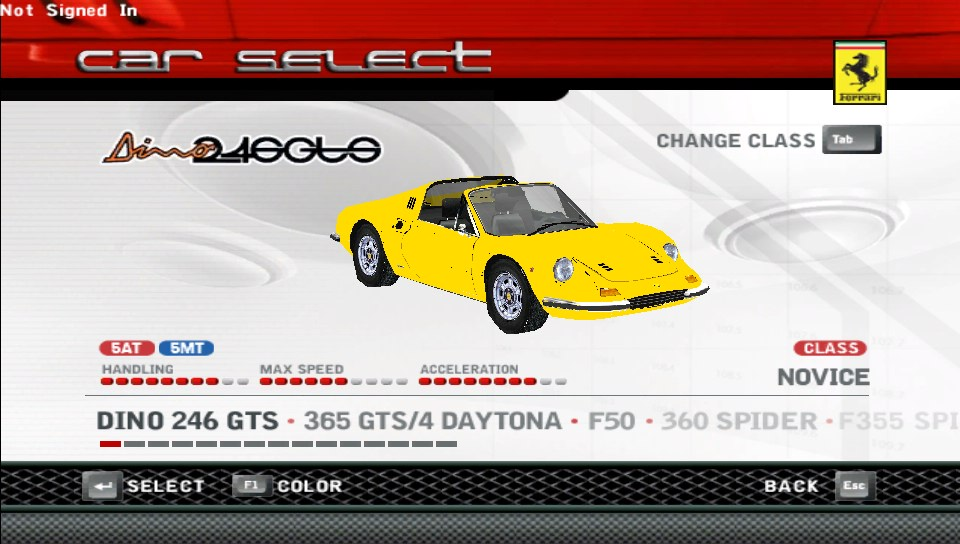
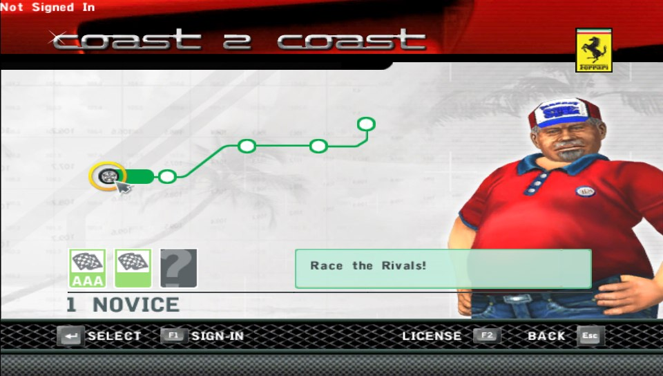
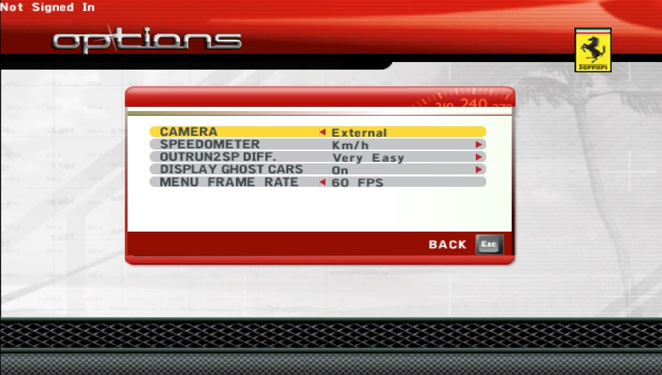

# OutRun 2006: Coast 2 Coast — PS Vita Port

> [English](README.md) | **Español**

Port nativo de **OutRun 2006: Coast 2 Coast** (versión PC / Steam) para **PlayStation Vita**, basado en el proyecto [`outrun2-decomp`](https://github.com/r4dius/outrun2-decomp).

Ejecuta el motor decompilado del juego de PC de forma nativa sobre **ARM Cortex-A9 + vitaGL (PowerVR SGX543MP4+)** a resolución nativa **960×544** y **30 FPS estables en carrera** (hasta 60 FPS en menús).

## Capturas (PS Vita — 960×544)

| Pantalla de título | Menú principal |
| :---: | :---: |
|  |  |

| Selección de coche | Selección de música |
| :---: | :---: |
|  |  |

| Salida (Flagman) | En carrera |
| :---: | :---: |
|  |  |

| OutRun 2 SP — Heart Attack | Opciones |
| :---: | :---: |
|  |  |

---

## Estado actual — Qué funciona

- **Resolución nativa de PS Vita (`960×544`, 16:9).**
- **30 FPS bloqueados en carrera** con 2 ticks de simulación de 60 Hz por frame (velocidad real 1×, sin cámara lenta) y **60 FPS opcionales en menús** (`Options > Settings > MENU FRAME RATE`).
- **Arquitectura multi-núcleo en PS Vita:**
  - **Core 0:** hilo dedicado de `vitaGL` / GPU (command buffer doble asíncrono).
  - **Core 1:** lógica del juego, física y recorrido de escena.
  - **Core 2:** audio, trabajos paralelos de culling y descompresión asíncrona de archivos `.sz` (evita congelamientos al cargar tramos o tráfico).
- **Modos jugables:** OutRun (OutRun 2), Time Attack (OutRun 2), Coast 2 Coast (carreras estándar / rivales), Showroom, Car Select, Rankings, Licencias y Opciones.
- **Audio y música:** efectos de sonido y música del juego original (soporte Vorbis `.ogg`).
- **Cámara de inicio con el Flagman**, guardado de partidas/licencias en `ux0:data/outrun2006/SaveGame/`, y configuración mediante `options.ini` (`sd_logs=0` por defecto para no escribir logs a la SD).

---

## Qué falta por completar / Fallos conocidos

- **Modo Coast 2 Coast — Misiones de Clarissa (`variant 5` / Request Mode):**
  - Las 82 funciones de lógica bulk ya están compiladas en `vita/source/bulk_vita_tr.cpp`, pero faltan por conectar ~51 servicios externos en `src/platform/race_traffic_runtime.cpp` (14 de mates matriz/vector, 3 de CRT y ~34 getters/helpers de misiones y HUD). Actualmente se queda en pantalla en negro / bloqueado al llegar al primer servicio sin cablear (`0x48B140`).
- **Single Player y OutRun 2 SP:**
  - **OutRun 2 SP — Time Attack:** se queda en pantalla en negro (igual que en las misiones de Clarissa).
  - **Heart Attack (OutRun 2):** no aparece el bocadillo de misiones en pantalla (solo salen los marcadores de inicio y fin de misión en la carretera).
  - **Heart Attack (OutRun 2 SP):** aparece el bocadillo de misión, pero no ejecuta los eventos de la misión (aparición de tráfico especial, objetivos, etc.), aunque sí salen los marcadores de inicio y fin en la carretera.
- **Multijugador online / LAN:**
  - No implementado/probado en PS Vita.

---

## Limitaciones técnicas en PS Vita (qué no se puede hacer o no es viable)

- **60 FPS estables en carrera:** el cuello de botella está en CPU (ARM Cortex-A9 a 444 MHz ejecutando el código x86 traducido + física + recorrido de escena). A 30 FPS con 2 ticks de 60 Hz queda margen estable (~5–8 ms libres); intentar 60 FPS en carrera provoca caídas constantes.
- **Reflejos dinámicos en cubemap (6 caras por frame) y shaders DX9 originales:**
  - La versión de PC renderiza un cubemap de entorno de 6 caras cada frame (`0x414340`) y usa pixel/vertex shaders DirectX 9 (`vs_1_1` / `ps_1_4`).
  - En PS Vita se usa el pipeline fijo de `vitaGL` para mantener el rendimiento, y el cubemap de 6 caras está desactivado porque multiplicaría las pasadas de escena y hundiría los FPS.
  - Por la misma limitación de `vitaGL`, mezclar `glUseProgram` con el pipeline fijo corrompe los draws de la carretera, y activar `GL_LIGHTING` por coche penaliza el rendimiento en Core 0. Para añadir reflejos/especular reales en GPU haría falta migrar todo el render 3D a un único shader Cg/GLSL unificado.
- **Sombras volumétricas stencil en coches (`car_shadows`):** desactivadas en Vita por el alto coste de fillrate/draw calls en PowerVR SGX543 (se mantiene la sombra proyectada bajo el coche).
- **Partículas `D3DPT_POINTLIST`:** ignoradas en `vita_gl_d3d9.cpp` y tope de 64 partículas simultáneas para mantener estables los 30 FPS.

---

## Instalación en PS Vita

### Requisitos
1. PS Vita o PS TV con **HENkaku / Enso** y **VitaShell**.
2. **`libshacccg.suprx`** instalado en `ur0:data/` (necesario para `vitaGL` / `vitashark` al compilar shaders en runtime — se instala con **ShaRKF00D**). *(**No** requiere `kubridge.skprx`, ya que es un port nativo y no un `so-loader` de Android.)*
3. Una copia original de **Steam** de **OutRun 2006: Coast 2 Coast** para PC (no sirven ejecutables de versión DVD retail, No-CD ni parcheados/FXT), incluyendo `OR2006C2C.EXE` y todas sus carpetas (`BK`, `Cars`, `Chr`, `Common`, `Driver`, `Media`, `OSO`, `Scripts`, `Sound`, `Sprani`, `Sprite`, `Stage`, `Text`, etc.).
   - `OR2006C2C.EXE` soportado (**versión Steam**): `962,560` bytes — SHA-256: `4876712f501640951d892069db826e431aede3e4ab87686fc1d556e26df9fec1`
   - **No** hace falta ejecutar ni desempaquetar `OR2006C2C.EXE` en PC; el propio juego en PS Vita lo procesa automáticamente en el primer arranque y genera `OR2006C2C.cache`.
4. ~1.5 GB libres en `ux0:`.
5. **Overclock recomendado** (ej. PSVshell a 444/500 MHz CPU, 222 MHz GPU) para mantener 30 FPS constantes en todos los circuitos.

### Pasos
1. Instala `OutRun2006.vpk` desde **VitaShell** (acepta los permisos extendidos).
2. Crea la carpeta `ux0:data/outrun2006/` y copia dentro **todo** el contenido del juego de PC de modo que exista:
   ```text
   ux0:data/outrun2006/OR2006C2C.EXE
   ```
   junto con todas las carpetas de datos.
3. Abre **OutRun 2006 C2C** desde el LiveArea. En el primer arranque generará `OR2006C2C.cache` y `options.ini` automáticamente.

---

## Configuración (`ux0:data/outrun2006/options.ini`)

Ejemplo de opciones disponibles:

```ini
# OutRun 2006 PS Vita options v2 (edit or change in Options > Settings)
widescreen=1
framerate=60
lod_culling=6
lod_bias=1
sd_logs=0
```

- `framerate`: `60` o `30` — solo aplica a los **menús** (también configurable en `Options > Settings > MENU FRAME RATE`); las carreras siempre van bloqueadas a 30 FPS.
- `lod_culling`: distancia de recorte por tamaño proyectado (`7` = PC original, `6` = por defecto, `5` o `4` = recorta más objetos lejanos).
- `lod_bias`: nivel de detalle geométrico (`0` = PC original, `1` = por defecto, `2..3` = mallas más simples antes).
- `sd_logs`: `0` = apagado (por defecto, cero escritura de logs en la SD); `1` = activa los logs de telemetría/profiler (`profile_*.log`, `render_bottleneck_*.log`) para depuración.

---

## Script opcional de preparación de assets para PS Vita (`tools/prepare_vita_assets.py`)

[tools/prepare_vita_assets.py](tools/prepare_vita_assets.py) unifica en un solo archivo dos utilidades opcionales pensadas para ejecutarse en la raíz del juego en PC (junto a `Cars/`, `mv/` y `OR2006C2C.EXE`). **Nunca modifica tus archivos originales** y escribe únicamente los archivos generados/modificados dentro de `vita_assets/` conservando la estructura exacta del juego.

### Qué hace cada función por separado

1. **Pantalla de introducción (`--only-intro`, requiere `ffmpeg`):**
   - **Qué hace:** Extrae 1 frame fijo (segundo `4.0` por defecto, configurable con `--time`) y la pista de audio original de `mv/TitleScreen.bik`, generando `vita_assets/mv/TitleScreen.bmp` (~900 KB) y `vita_assets/mv/TitleScreen.ogg` (~1–1.5 MB en Ogg Vorbis 48 kHz estéreo).
   - **Cómo funciona:** La versión de PS Vita no incluye decodificador FFmpeg/Bink. En su lugar, el motor de Vita carga `mv/TitleScreen.bmp` una sola vez como textura de fondo detrás de `PRESS START` y reproduce `mv/TitleScreen.ogg` en bucle con `libvorbisfile`, deteniéndose al pulsar Start. Una vez copiados, puedes borrar `mv/TitleScreen.bik` (~78 MB) de la Vita para ahorrar espacio.
2. **Optimización de polígonos de coches del jugador (`--only-cars`, requiere `Blender`):**
   - **Qué hace:** Busca automáticamente **solo** los 31 coches del jugador (`Cars/obj_plcar*_pmt.sz`), los reduce con Blender en segundo plano (`--ratio 0.5` por defecto), protege cristales y calcomanías (`_Pass1`, aplicando un offset de `+3.5 mm` en la normal para evitar z-fighting), reconstruye los `Triangle Strips` nativos `PMT` + `zlib` nivel 9 y los guarda en `vita_assets/Cars/`.
   - **Cómo funciona:** Aplica el modificador `DECIMATE (COLLAPSE)` de Blender manteniendo UVs y materiales, y reempaqueta tanto el vertex buffer como el index buffer.

### Cómo ejecutarlo y pasarlo a la PS Vita

1. Copia [tools/prepare_vita_assets.py](tools/prepare_vita_assets.py) a la raíz del juego en PC (junto a `Cars/`, `mv/` y `OR2006C2C.EXE`).
2. Ejecuta ambas funciones a la vez o solo la que necesites:
   ```bash
   python3 prepare_vita_assets.py               # Intro + coches de jugador
   python3 prepare_vita_assets.py --only-intro  # Solo intro BMP + OGG (ffmpeg)
   python3 prepare_vita_assets.py --only-cars   # Solo coches de jugador (Blender)
   ```
   *(Opciones útiles: `--ratio 0.5`, `--time 4.0`, `--out vita_assets`, `--ffmpeg /ruta/a/ffmpeg`, `--blender /ruta/a/blender`, `--dry-run`.)*
3. Entra en `vita_assets/` y arrastra las carpetas `Cars/` y/o `mv/` encima de `ux0:data/outrun2006/` en tu PS Vita, sobrescribiendo cuando lo pida.

### Impacto estimado en PS Vita (ejemplo: Ferrari Dino, ~18,000 sin optimizar vs ~14,000 optimizado)

En PS Vita el coche del jugador siempre está en primer plano (sin entrar en LOD lejano). Tomando el **Dino (`obj_plcar_dino_pmt.sz`)** como referencia en el contador del juego:

| Escenario (ejemplo: Dino en juego) | Conteo en juego (`prim_count`) | Diferencia estimada en GPU/submit (Core 0) | Efecto práctico en carrera (30 FPS) |
| :--- | :---: | :---: | :--- |
| **Sin optimizar (original)** | ~18,000 tris | Referencia (`+28%` más primitivas enviadas que el optimizado) | Más carga en picos de salida / tráfico denso (`~0.8–1.5 ms` extra por frame en zonas límite) |
| **Optimizado con `prepare_vita_assets.py` (`--ratio 0.5`)** | ~14,000 tris | `~0.8–1.5 ms` menos en GPU/submit + menor uso de VRAM/IB | Menos micro-caídas en salidas con rivales y carga algo más rápida; **no** desbloquea 60 FPS porque el cuello principal sigue en CPU (Core 1) |

#### ¿Por qué en el juego salen más polígonos que los que muestra Blender (tanto sin optimizar como optimizado)?
- **Triángulos degenerados de `Triangle Strip` (`D3DPT_TRIANGLESTRIP`):** el motor de OutRun 2006 dibuja los modelos como tiras continuas (*triangle strips*). Para saltar de una pieza/isla a otra dentro del mismo draw call se insertan índices repetidos (triángulos degenerados de área cero). Blender solo cuenta los polígonos reales (~13,400 en el Dino original), pero el contador del juego cuenta `índices - 2` incluyendo esos puentes degenerados (~18,000). Al decimar en Blender se rompe la continuidad original de las tiras y al reconstruir los strips se necesitan más puentes degenerados, por lo que aunque Blender muestre menos polígonos reales, el total en juego queda alrededor de ~14,000.
- **Partes protegidas e instanciadas:** el script deja intacta la pasada `_Pass1` (cristales y calcomanías para no romper transparencias) y el motor dibuja en pantalla las ruedas/piezas instanciadas del coche junto a la carrocería, que también suman al conteo final en carrera.

---

## Controles en PS Vita

| Botón PS Vita | Acción |
| :--- | :--- |
| **Stick Izquierdo / Cruceta** | Dirección / Navegar menús |
| **Gatillo R** | Acelerar / Cambiar clase de coche (Normal ↔ OutRun) |
| **Gatillo L** | Frenar / Derrapar |
| **Cruz (X)** | Confirmar / Seleccionar / Subir marcha |
| **Círculo (O)** | Atrás / Cancelar |
| **Cuadrado (□)** | Bajar marcha |
| **Triángulo (△)** | Cambiar cámara / Cambiar color del coche / Música aleatoria |
| **Start** | Pausa / Confirmar |
| **Select** | Mostrar/Ocultar overlay de estadísticas |

---

## Cómo compilar desde código fuente (Linux / WSL)

### Requisitos de compilación
- **VitaSDK** instalado (`$VITASDK` configurado en el entorno).
- **CMake >= 3.16**, `make` y compilador `arm-vita-eabi-g++`.
- Librerías de VitaSDK: `SDL2`, `libvorbis` / `libogg`, `vitaGL`, `vitashark`, `mathneon`, `zlib`, `pthread`.

### Compilar el `.vpk` y `eboot.bin`
```bash
export VITASDK=/ruta/a/tu/vitasdk
export PATH=$VITASDK/bin:$PATH

cmake -S vita -B vita/build
cmake --build vita/build -j$(nproc)
```

Los artefactos generados estarán en:
- `vita/build/OutRun2006.vpk` (instalador completo para VitaShell)
- `vita/build/eboot.bin` (ejecutable para actualizar instalaciones existentes en `ux0:app/OR2006C2C/eboot.bin`)

*(Opcional: añade `-DOR2_VITA_HEAVY_PROFILE=ON` al comando `cmake` si deseas habilitar el conteo detallado de polígonos por modelo junto con `sd_logs=1`.)*

---

## Créditos y avisos legales

- Basado en [`outrun2-decomp`](https://github.com/r4dius/outrun2-decomp) por **r4dius**.
- Compilado con **VitaSDK** y **vitaGL**.
- Este repositorio **no incluye** archivos, ejecutables ni assets con copyright de *OutRun 2006: Coast 2 Coast* (SEGA / Sumo Digital). Debes aportar tus propios archivos del juego original de PC.
- Ver [THIRD_PARTY_NOTICES.md](THIRD_PARTY_NOTICES.md) para licencias de terceros.
